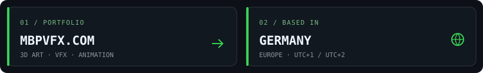
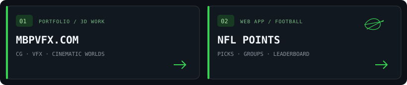

<h3><code>bamf-venom@github ~ $ ./contributions.sh</code></h3>

  

<h3><code>bamf-venom@github ~ $ whoami</code></h3>

<table>
<tr>
<td valign="top"></td>
<td valign="top"></td>
</tr>
</table>

 

### <code>bamf-venom@github ~ $ ./stack.sh</code>

### <code>bamf-venom@github ~ $ ./links.sh</code>

 &nbsp; <code>BASED IN GERMANY</code>

### <code>bamf-venom@github ~ $ ./projects.sh</code>

 &nbsp; 

<a href="https://github.com/bamf-venom/NFL">NFL Points source ↗</a>

 

3D ARTIST / CG GENERALIST &nbsp;·&nbsp; GERMANY

